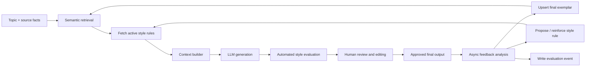

# Adaptive Style Memory Engine

> A human-governed agentic RAG pipeline that turns approved edits into better context—not model fine-tuning.

Most text-generation workflows start with a static prompt. That works until voice, formatting preferences, and standards evolve. Each new draft starts from roughly the same set of instructions, so the human editor repeats the same corrections.

This project is a dynamic-memory system for closing that loop. It retrieves relevant examples of approved writing, applies a versioned style rulebook, routes each draft through human review, and asynchronously learns from the difference between the draft and the final version.

The goal is not to make an LLM “sound human” in the abstract. The goal is to make its outputs more consistent with a specific, evolving editorial standard while keeping a human in control of what becomes persistent memory.

## The problem

Style is hard to express as a single prompt. It lives in patterns: sentence length, paragraph rhythm, word choice, structure, what gets removed, and what gets emphasized.

Fine-tuning may be unnecessary or impractical for a small, changing corpus. A prompt-only solution, meanwhile, has no reliable way to use the best historical examples or learn from edits.

This system uses two complementary forms of memory:

| Memory type | What it stores | Why it exists |
| --- | --- | --- |
| **Exemplar memory** | Approved final posts with metadata and embeddings | Retrieves semantically relevant few-shot examples for a new topic. |
| **Style-policy memory** | Atomic, versioned rules extracted from recurring edits | Keeps durable preferences explicit, compact, and auditable. |
| **Evaluation memory** | Draft/final diffs, scores, retrieval data, and latency | Measures whether the system is improving and helps diagnose regressions. |

## Architecture



The workflow is implemented in n8n, using Qdrant as the vector store. It can use a form, Slack, or Airtable as the human-review surface; those interfaces are intentionally interchangeable.

## Generation workflow

1. A request supplies a topic, content type, and grounded source facts.
2. Qdrant performs a Top-*K* search across **approved final** writing only. Metadata filters narrow the search by type, recency, or audience when applicable.
3. The workflow fetches active rules from the rulebook and builds a bounded context window: a small rule set, three high-quality exemplars, and the requested facts.
4. The generation model produces a draft.
5. An evaluator checks the draft for basic adherence and records diagnostics before it is sent for human review.
6. The human accepts, edits, or rejects the draft. Only the approved final version enters long-term exemplar memory.

### Context design

Retrieval is not a substitute for instructions. The prompt uses rules for persistent constraints and examples for cadence and local expression.

```text
ROLE
Draft a post in the established voice.

ACTIVE STYLE RULES
{{versioned_style_rules}}

RETRIEVED APPROVED EXEMPLARS
{{top_k_exemplars}}

TASK
Write about: {{topic}}
Use only these source facts: {{key_points}}

CONSTRAINTS
- Match the examples' pacing and structure; do not copy phrases.
- Do not invent facts.
- Prefer direct technical language over corporate filler.
- Keep paragraphs short and start with the core point.
```

The context builder applies a token budget. If retrieval is low-confidence, empty, or unavailable, generation continues with the active rulebook and a compact default style guide. A retrieval outage should reduce personalization, not break publishing.

## Feedback workflow

Human edits are useful signals, but one edit should not silently become a global rule. The asynchronous feedback workflow compares the original draft with the approved final version and produces a structured proposal:

```json
{
  "observation": "Corporate framing was replaced with direct technical language.",
  "candidate_rule": "Prefer direct technical language; remove unsupported business-value framing.",
  "scope": "global",
  "confidence": 0.86,
  "evidence_type": "draft_final_diff"
}
```

The final post is embedded and upserted into Qdrant as a new exemplar. Candidate rules are deduplicated, versioned, and promoted only after human approval or repeated supporting evidence. This avoids turning a topic-specific choice into a permanent instruction.

## Reliability and fallbacks

The pipeline is designed as an automation system, not a linear demo.

- **No retrieval results:** use the default style guide plus active rules; log the fallback event.
- **Low similarity results:** omit weak exemplars rather than contaminating the prompt.
- **Vector-store outage:** continue in degraded mode with the rulebook; queue the event for later ingestion.
- **Evaluator failure:** preserve the human-review path and record the failed evaluation separately.
- **Duplicate or stale examples:** deduplicate by content hash and use metadata-aware filters and recency weighting.
- **Unsafe rule proposal:** hold it as a candidate until promoted; no evaluator can mutate active policy directly.

## Evaluation

The system should earn the word “improving.” I track it against a static-prompt baseline using periodic evaluation runs over a held-out set of topics.

| Metric | What it answers |
| --- | --- |
| **Human edit distance** | Are approved outputs requiring fewer changes? |
| **Style-adherence score** | Does an independent evaluator find fewer style violations? |
| **Acceptance rate** | How often is a draft approved with little or no revision? |
| **Retrieval usefulness** | Do higher-similarity examples correlate with better outcomes? |
| **Token and latency budget** | Is the added context improving quality efficiently? |
| **Fallback rate** | How often does the workflow operate in degraded mode? |

I avoid claiming that the model is retrained. The model weights stay fixed. The improvement comes from better retrieval, curated exemplars, and governed updates to the prompt policy.

## Technology

- **Orchestration:** n8n
- **Vector retrieval:** Qdrant
- **Embeddings:** provider-configurable embedding model
- **Generation and evaluation:** provider-configurable LLM nodes
- **Human approval:** n8n Form, Slack, or Airtable
- **Persistent state:** Qdrant metadata plus a versioned rulebook and evaluation log

## What this demonstrates

This is a compact example of production-minded agentic RAG design:

- Context engineering with semantic few-shot retrieval and explicit token budgets.
- Memory design that distinguishes examples, policies, and measurement data.
- Human-in-the-loop governance for persistent behavior changes.
- Asynchronous feedback processing instead of blocking the publishing path.
- Graceful degradation when retrieval or evaluation services fail.
- Observable quality improvement rather than subjective claims of “better output.”

## Next steps

The next iteration will add a small evaluation dashboard, rule-promotion review UI, and retrieval-quality experiments comparing semantic similarity, metadata filtering, and recency-weighted ranking.

If you are building agentic systems, the key lesson is simple: memory is not just a vector database. Useful memory needs retrieval, policy, evaluation, provenance, and a lifecycle.
